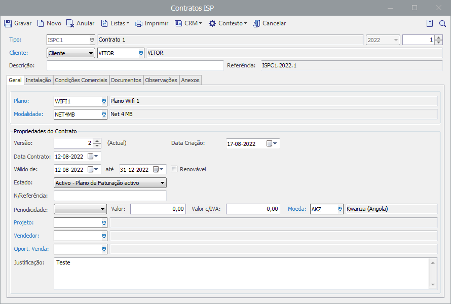
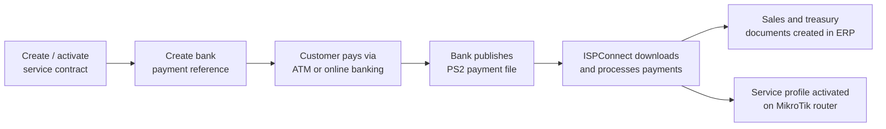

# ISPConnect

**An integrated module for the Primavera ERP that automates the commercial lifecycle of an Internet Service Provider (ISP): from signing a service contract to activating the customer's Internet connection.**

ISPConnect connects three systems that are usually operated separately: the **bank payment network**, the **ERP billing and accounts system** and the **network access equipment**. A customer contract triggers a bank payment reference, the payment is confirmed automatically, the invoice is issued, and the service is switched on, with no re-keying of data between applications.

> 📷 Screenshots of the module are available in [screenshots.md](screenshots.md).



---

## Table of contents

- [Purpose](#purpose)
- [How it works](#how-it-works)
- [Key features](#key-features)
- [Integrations](#integrations)
- [Architecture](#architecture)
- [Technology stack](#technology-stack)
- [Licensing](#licensing)
- [Project background](#project-background)

---

## Purpose

Many organisations lose time and money because a single business process is spread across disconnected tools: the same information gets typed into several systems, which leads to delays, synchronisation errors and extra cost. Horizontal ERP functionality rarely covers the specific needs of a sector like Internet provisioning.

ISPConnect is a **vertical solution** built on top of **Primavera ERP v10** for an ISP operating in Angola. It manages the full lifecycle of an Internet customer with a contractual relationship to the provider:

1. Register the service contract.
2. Create the bank payment reference.
3. Confirm and register electronic payments.
4. Issue the billing documents.
5. Activate the service on the customer's router.

Because it runs inside the Primavera environment, it reuses the ERP's billing, current accounts, treasury and user-profile systems instead of duplicating them.

## How it works



A background service periodically creates or removes pending bank references, retrieves the payment files, maps every payment to its contract and customer, and triggers billing and activation automatically.

## Key features

### Contract management
- Register ISP service contracts with customer data, address, associated equipment, plan and payment mode.
- Bank reference is created on contract activation and removed on cancellation, automatically.
- Create references for existing contracts, or retry those that failed because of earlier communication errors.
- Every reference is bound to exactly one contract.
- Detailed history of service activations per contract.
- Explorer views to query contracts by type, status and date range.

### Bank payments
- Automatic creation and removal of payment references through the bank's web services.
- Payment collection through the **EMIS / Multicaixa** network (ATMs and online banking).
- Automatic download and processing of payment files, with a polling interval configurable by the ERP administrator.
- Interface for manual payment confirmation.
- Each payment record is mapped to the customer and contract identified by its reference.

### Billing and treasury
- Configurable sales and treasury documents generated from confirmed payments, posted to the associated bank account.
- Partial payments (for example when a plan's price differs from the amount paid) are recorded as a **customer advance (ADC)**.
- Fully integrated with the ERP's billing and current accounts modules.

### Automatic service activation
- Service profiles, customer users and activations are created and maintained directly on the network equipment.
- Activation is triggered automatically once a payment is confirmed.
- The services tied to a confirmed payment are identified automatically and activated on the connected equipment.

### Security and administration
- Uses the **Primavera profile system**: features are registered in the ERP administration tool and every component checks the current user's access level.
- Access restricted to users approved by the system administrator.
- Built-in **licensing utility** for commercial limits such as number of users or maximum number of contracts.

## Integrations

| System | Purpose | Method |
|---|---|---|
| **Primavera ERP v10** | Host platform: billing, current accounts, treasury, profiles | Native ERP API and extensibility interfaces |
| **Banco Económico (BE)** | Create/remove payment references (Interfaces 960, 961, 962) | SOAP web services |
| **Banco Económico (BE)** | Retrieve payment files (PS2, CSV format) | SFTP over OpenSSH, 2048-bit RSA key authentication |
| **MikroTik RouterOS** | PPPoE service profiles, users and activation (UserManager) | RouterOS API with an administrative account |

### Payment reference format

```
{product code [1]}{series/year [4]}{contract number [5]}
```

Example: `1202400001` is product 1, series 2024, contract no. 1.

### Pluggable bank integrations

The banking layer loads integration **assemblies dynamically**. Each assembly contains the business rules and procedures for one specific bank, so support for additional electronic payment providers can be added without changing the core module. Banco Económico is the first implementation. The same approach allows other network equipment vendors to be supported alongside MikroTik.

## Architecture

ISPConnect follows the Primavera extensibility guidelines and an **N-Tier** structure, with each layer in its own assembly:

| Layer | Assembly | Naming convention | Example |
|---|---|---|---|
| Business Entities | `ISPBEXXX.dll` | `{APL}BE{Entity}` | `ISPBEContrato` |
| Business Services | `ISPBSXXX.dll` | `I{APL}BS{Entity}` | `IISPBSContratos` |
| Data Services | `ISPDSXXX.dll` | `I{APL}DS{Entity}` | `IISPDSContratos` |
| User Interface | `ISPUSXXX.dll` | forms and editors | Contract editor, explorers |

The module ships as **two application blocks** configured using the ERP's own tools and interface, and is integrated into the ERP shell through a dedicated ribbon tab.

**User interface components**

- **Ribbon tab** with all ISPConnect commands.
- **Setup tables:** equipment types, equipment, plans and services, contract types, payment interfaces (MCX).
- **Editor:** ISP contract editor.
- **Explorers:** contracts, bank references and PS2 files, payments and activations.

## Technology stack

| Area | Technology |
|---|---|
| Language / framework | C#, .NET Framework 4.7.2 |
| IDE | Microsoft Visual Studio 2019 |
| ERP platform | Primavera ERP v10 |
| Database | Microsoft SQL Server 2014 SP3 or later (ERP datastore) |
| Bank integration | SOAP web services, SFTP / OpenSSH, RSA 2048 |
| Network integration | MikroTik RouterOS API (UserManager, PPPoE) |
| Modelling | UML |
| Installer | Inno Setup |

**Development and test tooling:** SoapUI 5.7.0 (bank web services), WinSCP and OpenSSH (SFTP simulation), WinBox 3.35 (MikroTik administration).

## Licensing

The module includes a licensing utility that generates licence files according to commercial criteria (number of users, maximum number of contracts), with security mechanisms to protect the integrity of the licensed data and restrict use to valid customers.

## Project background

ISPConnect was developed as a software engineering project, with requirements validated by the client through a functional specification document, which was the project's first milestone. The full project documentation is written in Portuguese.

---

<sub>Built for Primavera ERP v10. Primavera and MikroTik are trademarks of their respective owners.</sub>
