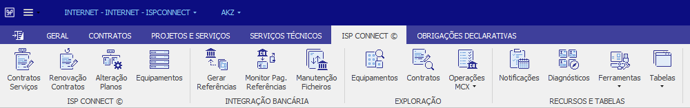
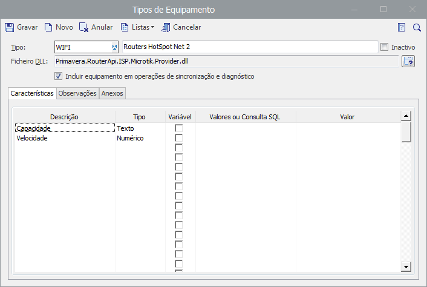
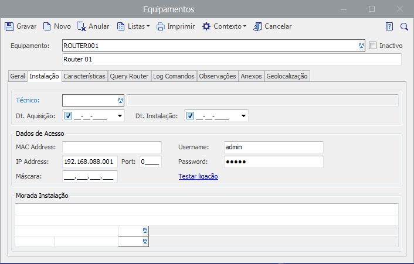
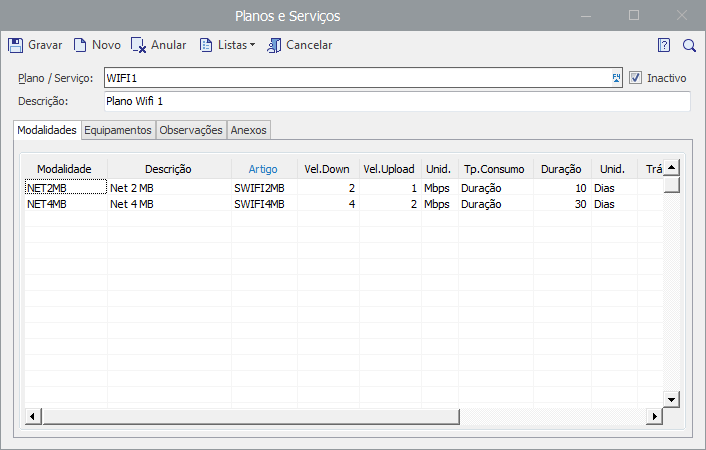
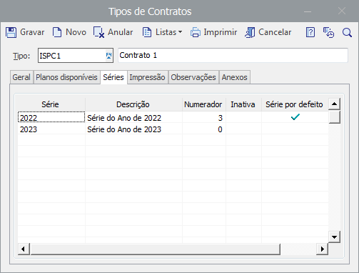
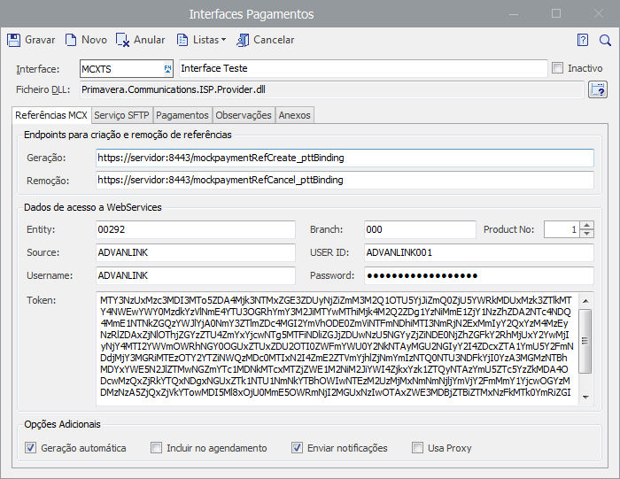
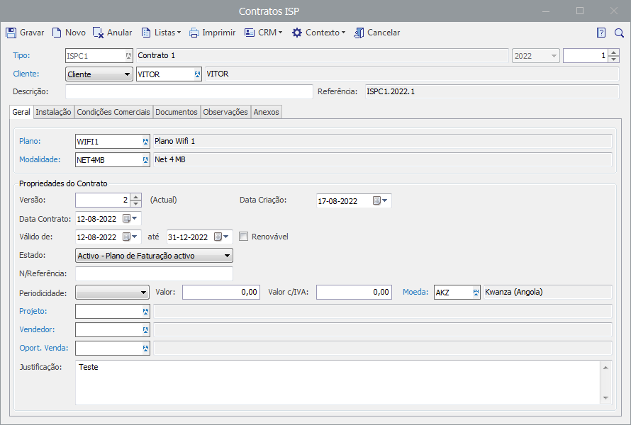
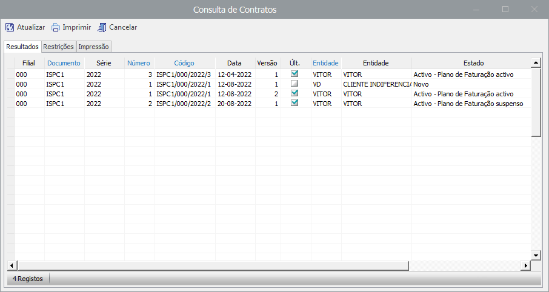
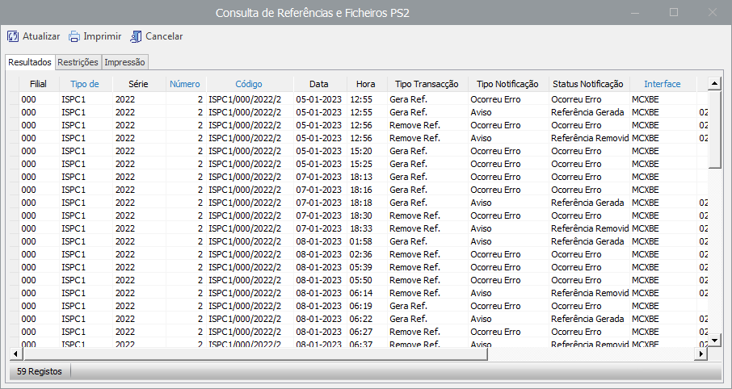
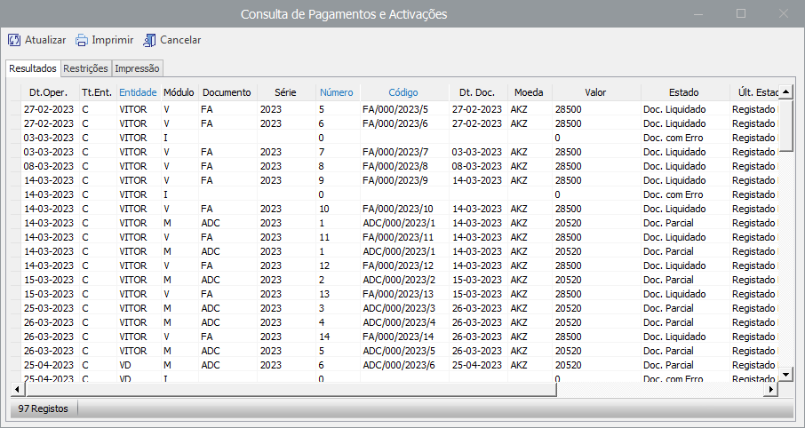

# ISPConnect: Screenshots

A visual tour of the ISPConnect module inside **Primavera ERP v10**. Back to the [README](README.md).

> Place the image files in a `screenshots/` folder at the root of the repository so the links below resolve.

## Contents

- [Application shell](#application-shell)
- [Setup tables](#setup-tables)
- [Contract editor](#contract-editor)
- [Explorers](#explorers)

---

## Application shell

### Ribbon and commands

ISPConnect is integrated into the ERP shell through an exclusive tab with access to all module features.

---

## Setup tables

Auxiliary tables that support the module and its communication APIs.

### Equipment types

Register equipment types with characteristics, notes and attachments.

### Equipment

Register equipment with location, access data, notes and attachments.

### Plans and services

Define Internet plans and services, with modalities and characteristics, allowed equipment, notes and attachments.

### Contract types

Define contract types with properties, available plans, document series, notes and attachments.

### Payment interfaces (MCX)

Configure bank communication interfaces: web service access data, SFTP server, payment documents, notes and attachments.

---

## Contract editor

The main editor of the module. It handles ISP contracts with status and validity, location, bank references and payment modes, generated documents, notes and attachments.

---

## Explorers

In Primavera terminology, an *explorer* is a form for browsing results and operations through customisable lists with filter criteria.

### Contracts

Contract list with a restrictions tab to filter by type, status, period and other criteria.

### Bank references and PS2 files

Bank references and PS2 payment files, filterable by type, status, period and other criteria.

### Payments and activations

Payments and service activations, filterable by type, status, period and other criteria.

